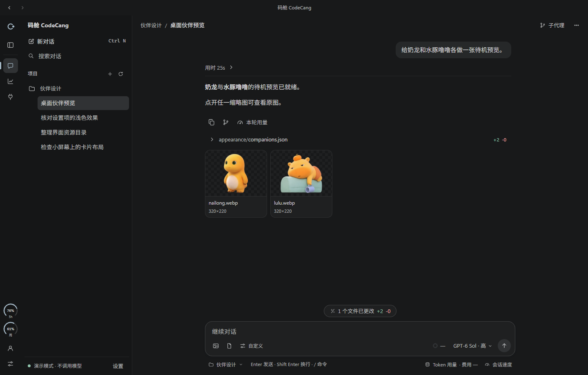
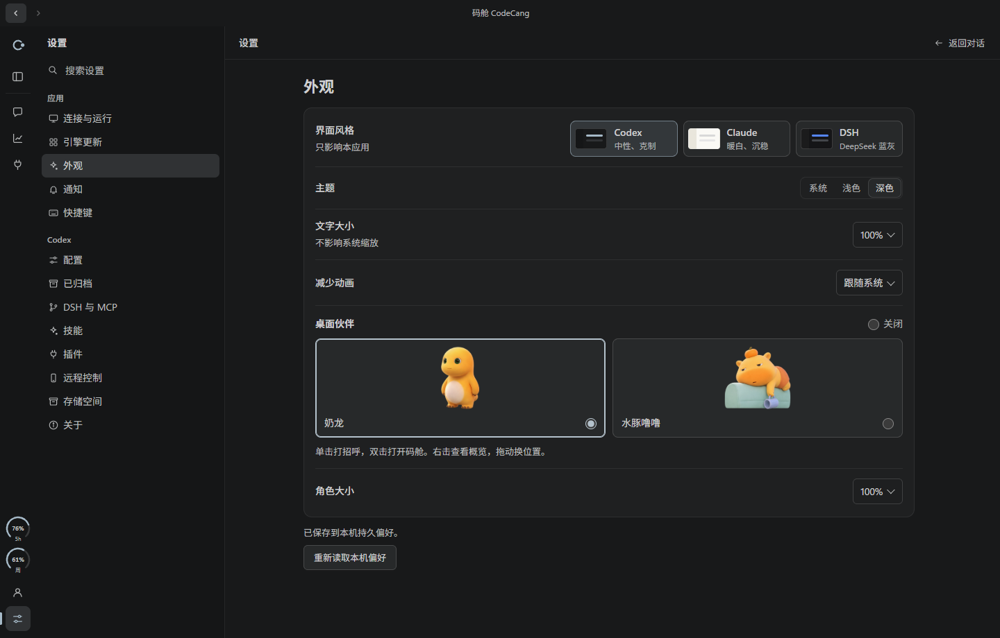
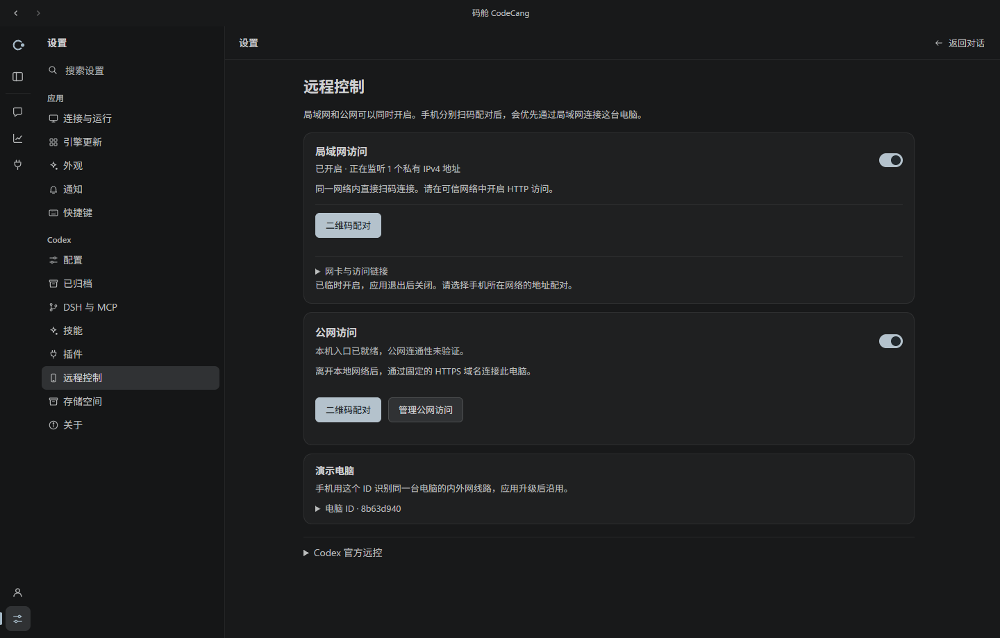
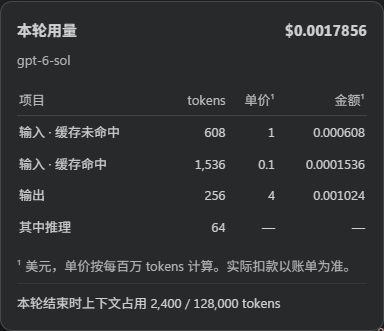
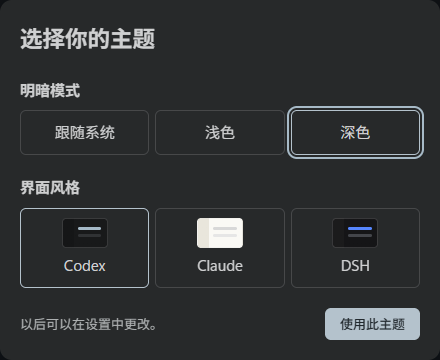
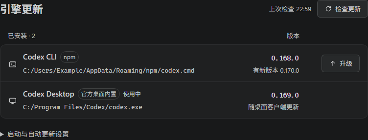

# 码舱 CodeCang

Codex 桌面与远程客户端（原 Codex Light）。英文名称为 **CodeCang**。

仓库地址、安装包文件名、Windows 更新身份、Android 包名及已有数据目录保持兼容，不需要因名称变化重新登录或迁移个人配置。详见 [品牌与兼容标识](docs/BRANDING.md)。

独立 Windows 桌面客户端，采用 WinForms + WebView2。通过官方 Codex CLI 的 app-server 协议工作，复用已有登录和配置；不改动官方客户端，不伪装成官方客户端。

## WSL 运行环境

v0.4.13 起，首次引导和打开「连接与运行」时会自动检测正在运行的 WSL 发行版，不会主动唤醒已停止的发行版，也不会切换已选引擎。发行版未运行，或 Codex 依赖登录脚本才能找到时，可点「完整检测 WSL」。选好 Linux Codex 后保存并重启，账户和数据按运行环境隔离。

已在 Ubuntu WSL 2 实测 Linux Codex 的发现和技能启停。WSL 原生 DSH 和真实任务的自动唤醒不在该次实测范围内。安装条件、操作步骤和限制见 [WSL 说明](docs/WSL.md)。

## 界面预览

以下为当前源码在 Windows Chrome 中实际渲染的桌面与手机界面。对话、文件变更及额度均为合成演示数据，不读取个人对话、不调用真实模型。手机图展示 Android WebView 共用的网页界面，不包含系统状态栏。

**电脑端 · 1440 × 920**



**手机端 · 1220 × 2656 物理像素**（模拟竖屏，CSS 视口 406 × 884，像素比约 3.005）


<details>
<summary>桌面伙伴、远程控制、本轮用量、首次主题选择与引擎更新</summary>











</details>

## 已实现的主要功能

- 会话：历史浏览、流式回复、停止、重命名、归档与分支；运行中可补充或排队。
- 项目与窗口：可拖动侧栏、项目菜单、系统文件夹选择、原生标题栏与托盘；过程操作可折叠。
- 模型：新对话记住选择的模型和思考强度，Fast 开启时在模型名旁显示闪电。支持运行中更改的引擎可将新设置用于本轮后续步骤，旧引擎从下一轮生效。
- 审批：命令、文件、基本表单及权限由用户确认；根据原生请求支持一次、对话或指定规则授权。
- 子代理：GPT 与可选 DSH 按对话统一展示，包含模型、来源、状态和时长；详情固定返回栏，后台刷新概览，文件修改汇入当前回合。
- 插件：优先显示已安装插件，也可浏览目录。支持确认后安装、卸载，以及在当前引擎允许时启用或停用。停用不会卸载插件，也不会撤销已有授权。
- 技能：在设置 → Codex → 技能中管理启用状态；本机桌面连接原生 Codex 时，可选择包含顶层 `SKILL.md` 的技能文件夹，确认后复制到个人技能目录。导入保留原文件，不覆盖现有技能，不执行包内内容；暂不支持 WSL、远程端或压缩包。
- 账户与用量：支持网页登录、设备码、套餐与额度、重置额度卡，以及按模型或供应商筛选用量。首次打开用量页先显示已保存的观测数据，再从本地日志补全。日志索引可跨重启复用，只重读新增或发生变化的文件。费用使用 models.dev 参考价格估算，回合平均输出 tok/s 包含思考、工具与等待。
- 附件：图片与文件单次共 5 个；上传和模型查看的图片可放大预览，支持项目外本地图片。文件作为本地路径引用，不自动执行或解包；可执行程序与脚本不接受。
- 设置：五项受支持配置的确认更新、版本冲突检查及本机偏好保存。
- 远程访问：管理官方远控和设备配对，也可通过可信局域网、自备的 frp、Cloudflare 命名隧道或自己的 Linux 服务器连接电脑。
- 外观与提醒：深色/浅色/系统外观、文字大小、减少动画、应用内提醒与快捷键清单。
- Windows 桌面伙伴可在「设置 → 外观」预览并选择奶龙或水豚噜噜，大小可调为 50% 到 200%。收进托盘后也能看到思考、执行命令、子代理协作、待答提问和额度状态。单击打招呼，双击打开码舱，右击可查看运行中的对话、子代理数量或调整大小。

## 安装与依赖

### Android 客户端

Android 客户端通过 WebView 使用电脑上的 Codex CLI。需要 Android 7.0（API 24）及以上、可用的系统 WebView，以及正在运行码舱的电脑。同一可信局域网可直接使用桌面端的「局域网访问」。外网连接需要在电脑端开启「公网访问」并配置固定 HTTPS 域名。仅支持私网 HTTP 的旧版 Android 客户端可继续使用局域网，外网配对可改用手机浏览器。

APK 获取、安装与升级、配对和 Windows 源码构建步骤见 [Android 客户端说明](android/README.md)。预构建 APK 随本仓库的 [Releases](https://github.com/k08255-lxm/codex-light/releases) 提供；请核对版本、来源及同一发布的 `SHA256SUMS.txt`。当前没有 GitHub Actions APK 自动构建工作流。

### 从外网连接电脑

1. 在电脑端打开**设置 → 远程控制 → 配置公网访问**。选择连接方式并填写 HTTPS 地址。自建服务器点击**连接服务器**，Cloudflare 或 frp 点击**开启公网入口**。本机端口默认为 `49321`，可在「端口与访问管理」调整。
2. 按下方任选一种方式，将该域名转发到同一台电脑的 **`http://127.0.0.1:49321`**。此地址是专供手机使用的回源端口。桌面窗口使用的管理端口应留在本机。码舱使用请求的 `Host` 校验域名，有非默认公网端口时也要保留端口。HTTPS 由公网入口提供。
3. 在电脑端点击**二维码配对**，用支持 HTTPS 配对的 Android 客户端扫码，或用手机浏览器打开配对链接。链接两分钟有效，只能兑换一次。可切到手机移动网络打开一个已有对话，确认能持续收到电脑端的更新。

公网设备可操作当前工作区，包括文件、终端和任务批准。请只向可信设备发放配对链接，并选择你信任的 HTTPS 终结服务，它可以读取转发的通信。点击**轮换公网令牌**可撤销此电脑的全部公网配对和现有连接。局域网有独立的令牌。关闭公网入口或退出码舱也会使当前公网配对失效，下次须手动开启并重新配对。

每台电脑首次使用时生成独立的远控 ID，保存在当前用户的码舱数据目录。常规应用更新、重启和切换 Codex 引擎均沿用该 ID。清除用户数据会生成新 ID，克隆整个数据目录到另一台电脑会复制身份。分别配对同一台电脑的局域网和公网地址后，Android 在建立连接时优先尝试内网，内网不可达时才尝试已配对的公网入口。

#### 使用自己的 Linux 公网服务器

1. 在运行 systemd 的 Debian 或 Ubuntu 服务器上，为这台电脑准备一个域名，设置指向 VPS 的 A 或 AAAA 记录。只有 AAAA 记录时，手机和电脑都需能访问该 IPv6 地址。
2. 在「设置 → 远程控制 → 配置公网访问」选择「自己的 Linux 服务器」并填写域名。首次配置展开「首次使用？配置 Linux 服务器」，点击「获取安装命令」，在服务器上以 root 身份执行。命令会校验当前版本脚本的 SHA-256。也可下载此电脑专用的脚本，上传到服务器后运行 `bash ./codecang-relay-setup.sh`。已注册的服务器可直接进行连接。
3. 需要避开现有站点的 443 时，在获取安装命令前勾选「安装时由服务器分配空闲公网端口」。脚本分配并保存 HTTPS 端口，新安装同时分配 SSH 端口。重复执行会沿用分配，已有服务器保留原 SSH 端口。默认部署继续使用 HTTPS 443 和 SSH 49323。按脚本输出放行两个公网 TCP 端口。
4. 把脚本输出的完整「桌面公网地址」填入「公网地址」，保留域名后的端口号，然后点击「连接服务器」。已开启的入口可直接更换地址，更换后需要重新配对公网设备。看到「公网已连接 · 已验证到这台电脑」后即可扫码。第二台电脑使用另一个子域名和它自己的安装命令。

已有 Caddy 或 Nginx 的服务器会使用本机回源端口。脚本在 `/etc/codecang-relay/frontends/` 生成该入口的两份接入配置，按终端提示选用实际接管公网 HTTPS 的服务。Caddy 在 Caddyfile 顶层导入专属站点文件。Nginx 使用对应域名的有效证书，在监听分配端口的 HTTPS `server` 块引入生成的 `location` 配置。使用独立端口时单独建站，可保留同域名的原有网站。检查配置后重载前置服务。没有前置代理时，中继可直接提供 HTTPS；独立端口模式使用 TCP 80 验证和续签证书。

生成的回源地址位于 VPS 的 `127.0.0.1`。前置代理采用容器部署时，示例适用于使用宿主机网络的代理。

在桌面点击「断开中继」可断开这条线路，服务器保留注册。下次点击「连接服务器」即可重新连接。如需永久撤销一台电脑，在服务器运行 `sudo /etc/codecang-relay/revoke <电脑ID>`。撤销后该注册的 ID、域名和公钥将保留为已撤销，其他电脑可继续使用。

#### 使用 Cloudflare 命名隧道

在 Cloudflare 控制台的 **Networking → Tunnels** 创建命名隧道，按页面提供的命令在运行码舱的电脑上安装并运行 `cloudflared`。在 **Routes → Add route → Published application** 添加公网主机名 `remote.example.com`，服务地址填 `http://127.0.0.1:49321`，路径留空。如已配置 **HTTP Host Header**，该值须与公网 Host 一致。使用已托管在 Cloudflare 的域名，以便它为此入口提供 DNS 和 HTTPS。临时 `trycloudflare.com` Quick Tunnel 不支持实时对话依赖的 SSE。[命名隧道配置](https://developers.cloudflare.com/tunnel/get-started/) · [Host 设置](https://developers.cloudflare.com/tunnel/reference/origin-parameters/) · [Quick Tunnel 限制](https://developers.cloudflare.com/tunnel/get-started/quick-tunnels/#limitations)

#### 使用自建 frp

已有公网服务器和 `frps` 时，可复用现有服务。在运行码舱的电脑上，将以下片段追加到已配置服务器地址和认证信息的 `frpc.toml`，替换公网域名与码舱端口。用 `frpc -c frpc.toml` 启动客户端，已作为服务运行的可用原方式重载配置。保留原始 Host，省略 `hostHeaderRewrite`。[frp HTTP 虚拟主机示例](https://gofrp.org/en/docs/examples/vhost-http/)

```toml
[[proxies]]
name = "codecang"
type = "http"
localIP = "127.0.0.1"
localPort = 49321
customDomains = ["remote.example.com"]
```

公网服务器的 `frps.toml` 需要启用 `vhostHTTPPort`（例如 `8080`），并允许同机 HTTPS 反向代理访问该端口。通过防火墙限制此 HTTP 端口仅供回源。将公网域名解析到这台服务器，配置有效证书，保留 `Host` 并实时转发 `text/event-stream`。使用 Caddy 自动管理证书时，向已有 Caddyfile 添加以下站点并重载，确保域名的 80、443 端口可达。[frps 配置](https://gofrp.org/en/docs/reference/server-configures/) · [Caddy 反向代理及流式响应](https://caddyserver.com/docs/caddyfile/directives/reverse_proxy)

```caddyfile
remote.example.com {
    reverse_proxy 127.0.0.1:8080
}
```

已有 frp 或 Cloudflare 命名隧道时，连接器和密钥由现有部署管理，码舱负责回源入口、配对和开关。使用码舱生成脚本的自建方案时，桌面端还负责 SSH 连接。

### Windows 桌面客户端

从本仓库 Release 下载 **`CodexLight-Setup-<version>-x64.exe`**（如 `CodexLight-Setup-0.4.24-x64.exe`），这是唯一需要手动下载的 Windows 安装入口。v0.4.6 起新安装内容已内嵌，不需要另下 ZIP；`full.nupkg` 和 `releases.win.json` 供应用自动更新使用。

0.4.4 起使用 Velopack。已有 Velopack 安装优先使用应用内更新；旧 MSI 安装先经固定的 0.4.4 迁移桥，再按提示更新到新版。首次安装复用兼容运行环境，缺失依赖须确认后才安装；完整应用的安装检查要求 Windows Node.js 22.15+（仅核心后端支持 Node.js 20+），WSL 内的 Node 不替代它。未检测到 Windows Codex CLI 时可选择稍后在应用中配置 WSL 或其他已有引擎。

安装与更新不代表每种电脑环境都已实机验收。共享运行时、项目和用户配置不应当作应用缓存清理；迁移恢复资料须保留。详见 [安装与升级](desktop/INSTALLATION.md)。

### DSH 集成（可选）

安装包默认携带 `components/dsh-bridge` MCP 桥。DSH 本体由用户自行安装，普通 Codex 聊天可以独立使用。已核验 Windows 桌面版 DSH 0.2.2-rc.3、0.2.3-alpha.2 和独立 CLI 0.2.2-rc.5、0.2.3-alpha.2。桌面桥复用 DSH 自带的 Node.js 与 SQLite。WSL 使用 0.2.3-alpha.2 CLI 时，需要 Node 24.x 的 24.22.3 及以上版本，或 Node 26.13.1 及以上版本。0.2.3-alpha.1 npm 包的 Cordis 依赖可能阻止启动，遇到此问题请升级至 alpha.2。码舱主应用仍支持 Node.js 20+。

连接步骤：

1. 打开左侧**设置 → DSH 与 MCP**，查看“DSH MCP 连接”卡片。
2. 已检测到 DSH 时，点击**连接 DSH**；若安装在其他位置，先填写 `DeepSeek Harness.exe` 的绝对路径。
3. 界面会仅添加 Codex 用户配置中的 `dsh_subagent` 一项，再检查实际连接状态，不发送模型请求。显示“已注册”或“刷新已排队”时，尚不能视为已连接；以页面报告的运行时状态为准。

已有同名外部 MCP 配置时会显示“使用已有配置”，保留并继续使用，不提供覆盖或替换操作。安装 DSH 本体本身不会自动注册 MCP；未安装或不连接 DSH，普通 Codex 聊天照常工作。

只使用 DSH 内置 DeepSeek 时，无需添加第三方 provider。需要额外 provider 时，可在同页选择配置来源并启用自动跟随；更新只用于新建 runtime，正在运行的任务继续使用原配置版本。

## 使用边界

- 需要完整官方交互的复杂插件审批，请在官方客户端处理。
- 用量覆盖取决于服务返回内容与历史格式，无法确认的数据保持未知。
- 启动后及运行期间自动检查 GitHub 稳定版，发现更新只提示；也可在设置 → 关于手动检查。已有 Velopack 安装核对更新包后，经用户确认并等待任务安全空闲才应用更新；不在启动时静默安装。目前没有代码签名。

## 开发与检查

Windows 构建完成后，`npm start` 启动原生窗口，`npm run browser` 才进入浏览器开发模式。`npm test` 运行无模型的 Node 测试。`npm run demo` 是明确标识的本地演示，不调用 Codex 或 DeepSeek。真实使用要求已安装官方 Codex CLI；Windows 从已安装的 npm 与桌面运行引擎中选择可用的新版本，也可显式配置 `CODEX_LIGHT_CODEX` 绝对路径。

应用本体依赖 .NET 10；对外安装入口及首次安装依赖引导目标为 Windows 自带的 .NET Framework 4.8。源码采用 MIT 许可证，第三方组件许可见 [THIRD-PARTY-NOTICES](docs/THIRD-PARTY-NOTICES.md)，技术结构见 [ARCHITECTURE](docs/ARCHITECTURE.md)。

### 从源码运行

需要 Node.js 20+。运行本地浏览器演示无需模型登录：

```powershell
npm run demo -- --browser
```

连接真实 Codex 时，先安装并登录官方 Codex CLI，再执行 `npm run browser`。桌面构建需要 .NET 10 SDK；先执行 `desktop/build.ps1` 生成完整应用 payload，再按 [Velopack 构建说明](desktop/velopack/BUILD.md) 生成当前宿主、更新 worker 和经校验的包，并按 [兼容安装入口说明](desktop/velopack/compat-router/README.md) 生成对外单文件 EXE。`desktop/msi` 与 `desktop/setup` 是历史 MSI 工具链，不是当前版本的常规发布路线。

普通 Codex 聊天与浏览器演示不需要安装 npm 依赖。源码模式需要使用 DSH 桥，或完整检查 DSH 的 YAML 解析能力时，先准备桥的锁定依赖与许可清单；这一步使用 Node.js 22.15+，以满足桥自身的版本要求：

```powershell
npm ci --prefix components/dsh-bridge --ignore-scripts --omit=dev
node components/dsh-bridge/build.mjs
```

`desktop/build.ps1` 会自动完成这两步并将桥及依赖许可打入默认 payload；安装包用户无需执行 npm。

随后运行无模型的 Node 测试：

```powershell
npm test
```

根 `package.json` 没有 npm 依赖，只在项目根目录执行安装不会准备桥的依赖。未准备桥依赖、且本机也没有可用 DSH YAML 解析器时，`npm test` 会跳过真实 YAML 解析器用例；DSH 缺失不会阻止服务启动或普通 Codex 聊天。上面的安装与 `build.mjs` 步骤用于获得完整检查覆盖，并校验桥依赖版本、生成许可清单与哈希元数据。

### 隐私与发布

服务默认只监听本机。在可信局域网开启访问时，可以直接选择当前全部私网 IPv4 网卡，每个地址都能生成配对码，优先展示物理网卡。此模式在本次运行有效。Windows 桌面端也可以指定一个可信网络并保存配对，凭据由当前用户的 DPAPI 加密。启动时或网络暂时中断后，码舱会在后台重试，等原可信网络、地址和端口可用时自动恢复，手机可沿用原配对。手动关闭局域网访问会取消恢复并撤销配对。局域网 HTTP 不加密，仅用于可信网络。桌面管理接口仅在本机开放。

真实模型请求由所选 Codex 引擎及用户配置的提供商处理。不要提交 `.env`、登录信息、会话日志、个人配置、测试截图或本地产物。此项目与 OpenAI 没有隶属关系。
