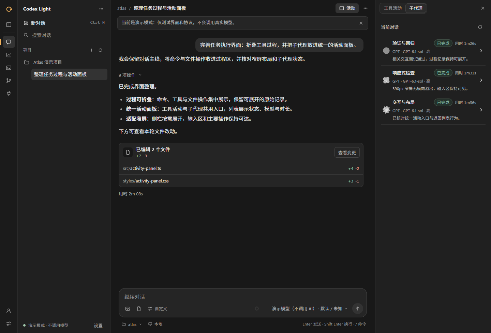
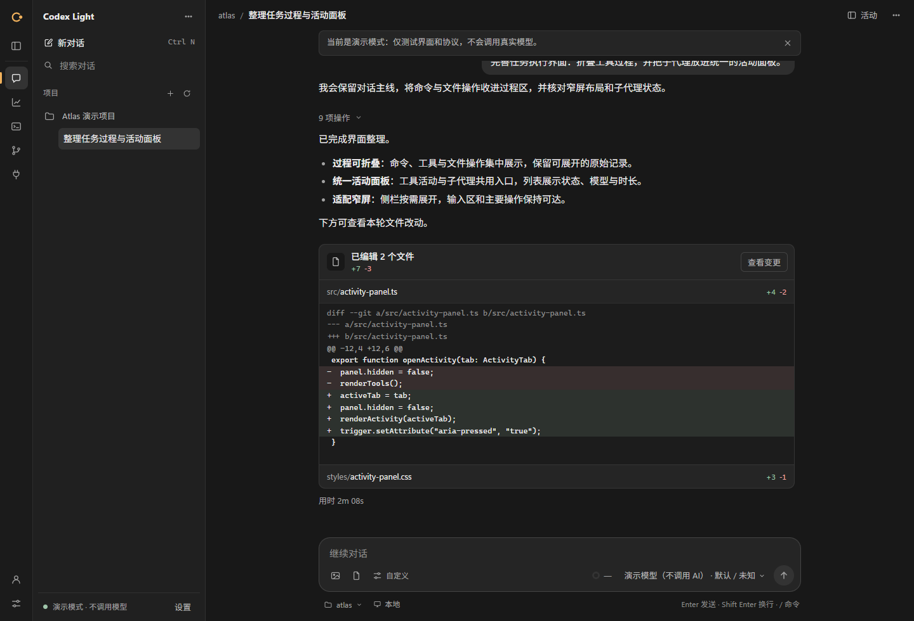
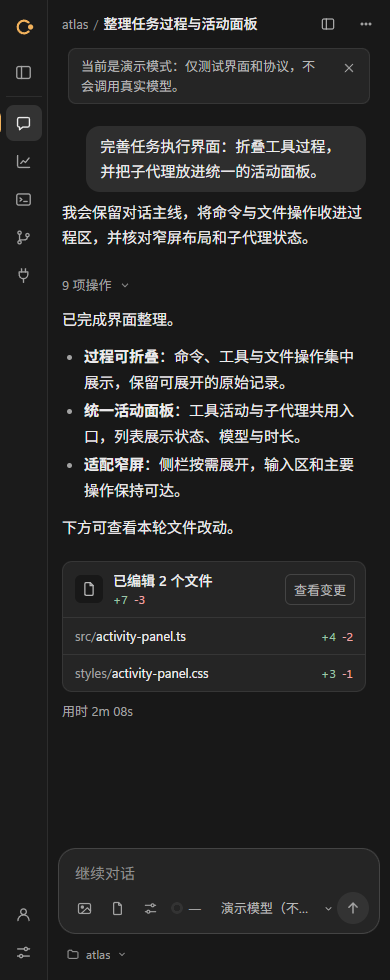

# 码舱 CodeCang

Codex 桌面与远程客户端（原 Codex Light）。英文名称为 **CodeCang**。

本次只更新显示名称；仓库地址、安装包文件名、Windows 更新身份、Android 包名及已有数据目录保持兼容，不需要重新登录或迁移个人配置。详见 [品牌与兼容标识](docs/BRANDING.md)。

独立 Windows 桌面客户端，采用 WinForms + WebView2。通过官方 Codex CLI 的 app-server 协议工作，复用已有登录和配置；不改动官方客户端，不伪装成官方客户端。

## 界面预览

以下为当前源码运行的浏览器演示截图，全部使用合成数据，不调用真实模型。宽屏为 1440px，窄屏为 390px。



<details>
<summary>查看文件 diff 与窄屏布局</summary>





</details>

## 已实现的主要功能

- 会话：历史浏览、流式回复、停止、重命名、归档与分支；运行中可补充或排队。
- 项目与窗口：可拖动侧栏、项目菜单、系统文件夹选择、原生标题栏与托盘；过程操作可折叠。
- 模型：按引擎提供的目录选择模型、思考强度、权限方式及 Fast 服务层级。
- 审批：命令、文件、基本表单及权限由用户确认；根据原生请求支持一次、对话或指定规则授权。
- 子代理：GPT 与可选 DSH 按对话统一展示，包含模型、来源、状态和时长；详情固定返回栏，后台刷新概览，文件修改汇入当前回合。
- 工作台：官方 PTY 终端，Git 状态、diff、暂存、提交与非强制推送；仓库过滤器和钩子的执行风险会提示确认。
- 插件：目录、详情及来源明确的安装/卸载确认。
- 账户与用量：网页登录、设备码、套餐/额度、重置额度卡、用量趋势、模型/供应商筛选与分页明细；扫描导入本地 Codex 日志，从 models.dev 同步价格，显示总成本及回合估价。参考估价不等于账单；回合平均输出 tok/s 包含思考、工具与等待。
- 附件：图片与文件单次共 5 个；上传和模型查看的图片可放大预览，支持项目外本地图片。文件作为本地路径引用，不自动执行或解包；可执行程序与脚本不接受。
- 设置：五项受支持配置的确认更新、版本冲突检查及本机偏好保存。
- 远程访问：官方远控状态、设备与配对管理；可随时关闭或更换链接的可选局域网访问。
- 外观与提醒：深色/浅色/系统外观、文字大小、减少动画、应用内提醒与快捷键清单。

## 安装与依赖

### Android 局域网客户端

Android 客户端是连接电脑的 WebView 外壳，不在手机上安装或运行 Codex CLI。需要 Android 7.0（API 24）及以上、可用的系统 WebView，以及已开启局域网访问的电脑。手机与电脑须在同一可信局域网；这不是公网远控或离线模型运行方式。

APK 获取、安装与升级、配对和 Windows 源码构建步骤见 [Android 客户端说明](android/README.md)。预构建包由贡献者的 Fork Release 提供，请核对版本、来源及校验文件；它不是本仓库的自动构建产物。

### Windows 桌面客户端

使用 Windows 发行包中的 **`CodexLight-Setup-<version>-x64.exe`**（如 `CodexLight-Setup-0.4.1-x64.exe`）。它是安装入口，负责检测并复用 .NET 10 Desktop Runtime、Node.js 20+ 和 WebView2；缺失时下载经过校验的官方运行时并安装。普通用户不需要手动安装 Node.js 或开发 SDK。

安装器内置 Windows Installer 包，已有正式安装沿用原目录升级；卸载使用 Windows 的“已安装的应用”。旧版非 MSI 目录不会被自动覆盖。项目、用户配置、会话和共享运行时不会随应用卸载删除。详见 [安装与升级](desktop/INSTALLATION.md)。

### DSH 集成（可选）

安装包默认携带 `components/dsh-bridge` MCP 桥，无需另找桥程序。DSH 本体由用户自行安装，缺失时普通 Codex 聊天照常工作。当前兼容 DSH 0.2.2，已核验 0.2.2-rc.1；桥使用 DSH 自带的 Node.js 22.15+ 与 SQLite，主应用仍只需 Node.js 20+。

连接步骤：

1. 打开左侧**设置 → DSH 与 MCP**，查看“DSH MCP 连接”卡片。
2. 已检测到 DSH 时，点击**连接 DSH**；若安装在其他位置，先填写 `DeepSeek Harness.exe` 的绝对路径。
3. 界面会仅添加 Codex 用户配置中的 `dsh_subagent` 一项，再检查实际连接状态，不发送模型请求。显示“已注册”或“刷新已排队”时，尚不能视为已连接；以页面报告的运行时状态为准。

已有同名外部 MCP 配置时会显示“使用已有配置”，保留并继续使用，不提供覆盖或替换操作。安装 DSH 本体本身不会自动注册 MCP；未安装或不连接 DSH，普通 Codex 聊天照常工作。

只使用 DSH 内置 DeepSeek 时，无需添加第三方 provider。需要额外 provider 时，可在同页选择配置来源并启用自动跟随；更新只用于新建 runtime，正在运行的任务继续使用原配置版本。

## 使用边界

- 需要完整官方交互的复杂插件审批，请在官方客户端处理。
- 用量覆盖取决于服务返回内容与历史格式，无法确认的数据保持未知。
- 设置 → 关于可检查 GitHub 最新稳定版、下载并核对 SHA256，再打开安装器完成更新；不自动静默安装。目前没有代码签名。

## 开发与检查

Windows 构建完成后，`npm start` 启动原生窗口，`npm run browser` 才进入浏览器开发模式。`npm test` 运行无模型的 Node 测试。`npm run demo` 是明确标识的本地演示，不调用 Codex 或 DeepSeek。真实使用要求已安装官方 Codex CLI；Windows 从已安装的 npm 与桌面运行引擎中选择可用的新版本，也可显式配置 `CODEX_LIGHT_CODEX` 绝对路径。

应用本体依赖 .NET 10；安装器目标为 Windows 自带的 .NET Framework 4.8。源码采用 MIT 许可证，第三方组件许可见 [THIRD-PARTY-NOTICES](docs/THIRD-PARTY-NOTICES.md)，技术结构见 [ARCHITECTURE](docs/ARCHITECTURE.md)。

### 从源码运行

需要 Node.js 20+。运行本地浏览器演示无需模型登录：

```powershell
npm run demo -- --browser
```

连接真实 Codex 时，先安装并登录官方 Codex CLI，再执行 `npm run browser`。桌面构建需要 .NET 10 SDK；执行 `desktop/build.ps1` 生成应用 payload，再依次使用 `desktop/msi/build.ps1`、`desktop/msi/verify.ps1`、`desktop/setup/build.ps1` 生成单文件安装器。内部 MSI 构建还需要 WiX 6.0.2，具体参数见各目录 README。

普通 Codex 聊天与浏览器演示不需要安装 npm 依赖。源码模式需要使用 DSH 桥，或完整检查 DSH 的 YAML 解析能力时，先准备桥的锁定依赖与许可清单；这一步使用 Node.js 22.15+，以满足桥自身的版本要求：

```powershell
npm ci --prefix components/dsh-bridge --ignore-scripts --omit=dev
node components/dsh-bridge/build.mjs
```

`desktop/build.ps1` 会自动完成这两步并将桥及依赖许可打入默认 payload；安装包用户无需执行 npm。

随后运行无模型的 Node 测试：

```powershell
npm test
```

根 `package.json` 没有 npm 依赖，只在项目根目录执行安装不会准备桥的依赖。未准备桥依赖、且本机也没有可用 DSH YAML 解析器时，`npm test` 会跳过真实 YAML 解析器用例；DSH 缺失不会阻止服务启动或普通 Codex 聊天。上面的安装与 `build.mjs` 步骤用于获得完整检查覆盖，并校验桥依赖版本、生成许可清单与哈希元数据。

### 隐私与发布

服务默认只监听本机。局域网访问首次默认关闭。Windows 桌面端开启后记住偏好及配对（凭据由当前用户的 DPAPI 加密），应用重启时尝试恢复同一可信网络、地址与端口；主动关闭才取消。网络变化或端口冲突时保留开启偏好，但实际访问保持停止并提示。其他环境仍为临时开启；持有链接的人可以使用本机工作空间。局域网 HTTP 不加密，仅用于可信局域网；应用不会自动修改防火墙或创建公网隧道。手机无法使用主程序关闭、运行引擎升级等本机管理接口。

真实模型请求由所选 Codex 引擎及用户配置的提供商处理。不要提交 `.env`、登录信息、会话日志、个人配置、测试截图或本地产物。此项目与 OpenAI 没有隶属关系。
